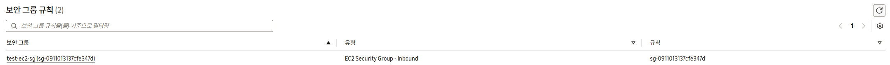
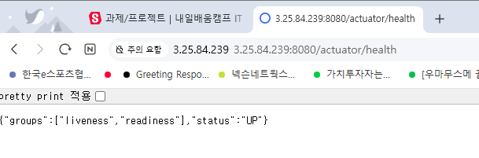
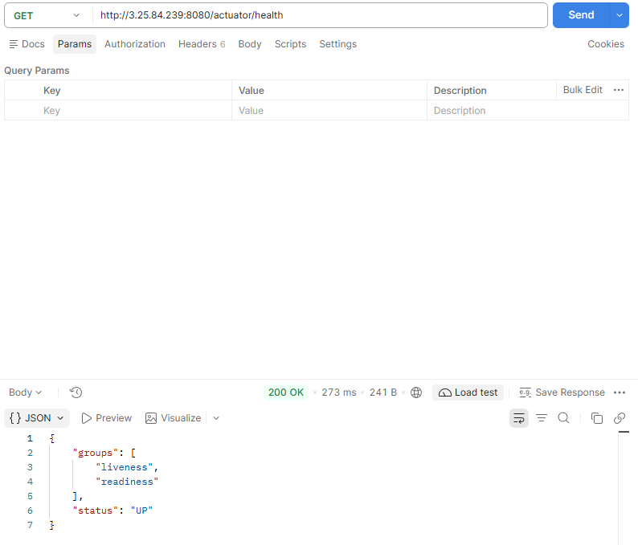
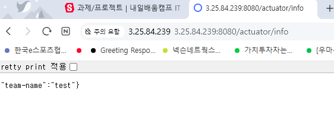
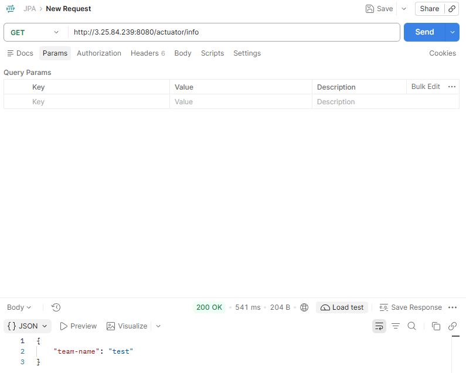
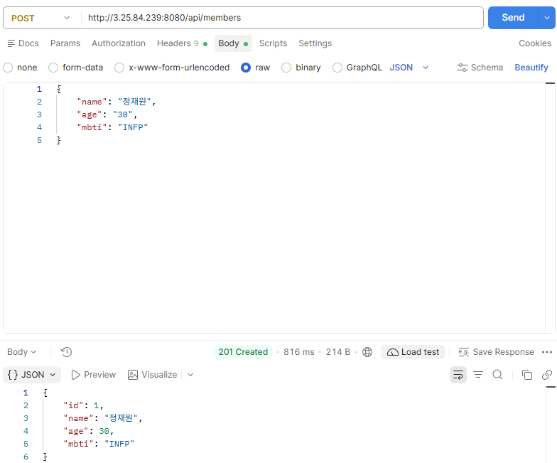
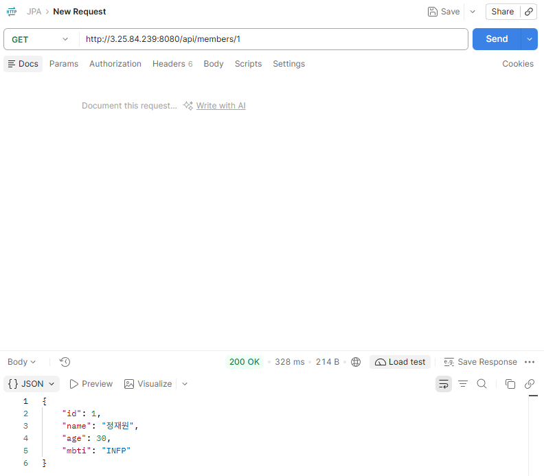
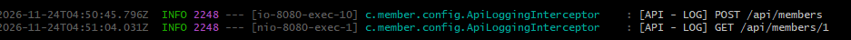

# 클라우드_아키택처 설게 & 배포

## 1. 아키텍처 및 인프라 구성 요약

### 1.1 네트워크 및 인프라 (VPC / EC2 / RDS)
- **VPC**: Public Subnet / Private Subnet 분리 구성
- **EC2**: Public Subnet에 배치, Spring Boot 애플리케이션 운영
- **RDS (MySQL)**: 로컬 테스트 접속용 Public Subnet 배치, 인바운드 규칙은 EC2 보안 그룹 ID(`sg-xxxxx`)만 허용(보안 그룹 체이닝)
- **AWS Systems Manager Parameter Store**: DB 접속 정보(`url`, `username`, `password`) 및 팀명(`team-name`) 등 설정값 관리

---

## 2. 배포 및 접속 정보

### 2.1 EC2 퍼블릭 IP (LV 1 필수)
- **EC2 Public IP**: `3.25.84.239`
- **애플리케이션 기본 URL**: `http://3.25.84.239:8080`

### 2.2 Actuator 엔드포인트 (LV 1 · LV 2 필수)
- **Actuator Info (Parameter Store 값 조회)**: `http://3.25.84.239:8080/actuator/info`
- **RDS 보안 그룹 스크린 샷**: 

---

## 3. 동작 및 연동 증빙
### 3.1 서버 헬스 체크 및 정보 조회

- **Actuator Health 응답**: `http://3.25.84.239:8080/actuator/health` 호출 결과(`UP` 상태 확인)
  - 
  - 
- **Actuator Info 응답**: `http://3.25.84.239:8080/actuator/info` 호출 결과(Parameter Store 설정값 반영 확인)
  - 
  - 

### 3.2 팀원 저장·조회 API 호출 결과

- **요청/응답 확인**: `POST /api/members` 및 `GET /api/members/1` 호출 화면 및 서버 로그(`ApiLoggingInterceptor`)
  - 
  - 
  - 
  
---
